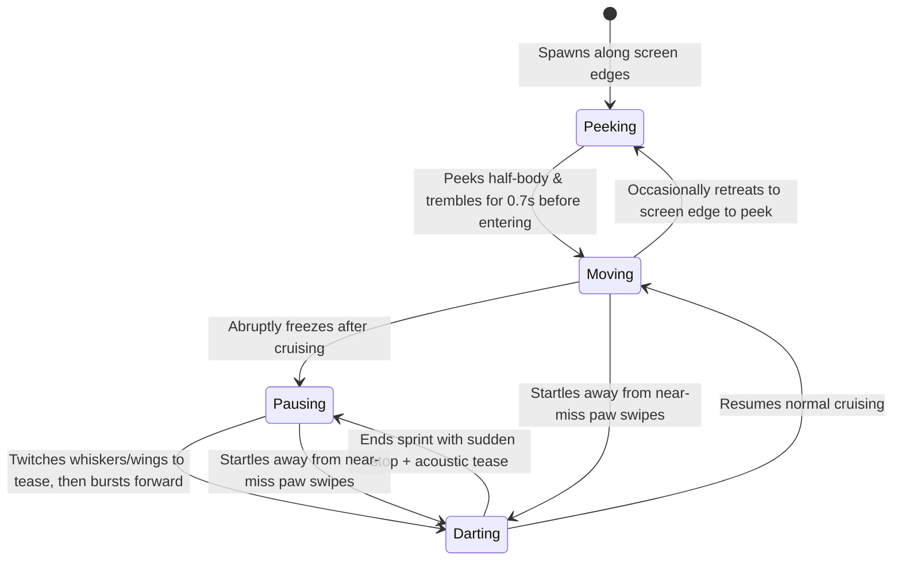

# 🐾 CatToy — Feline Dichromatic Vision & Biomimetic Hunting Playground for iPad

<p align="center">
  
</p>

<p align="center">
  <b>A Fullscreen Interactive iPad Game Engineered Around Feline Visual Neuroscience & Predatory Ethology</b><br/>
  Calibrated for Feline Dichromatic Retinas (450nm Cyan / 554nm Yellow) · Stop-and-Dart Bio-AI · Zero-Asset Procedural Audio Synth · Multi-Paw Safe
</p>

<p align="center">
  <a href="https://playcattoy.com"></a>
  <a href="https://playcattoy.com/play/"></a>
</p>

<p align="center">
  
  
  
  
  
</p>

<p align="center">
  <b>English</b> · <a href="README.zh-CN.md">简体中文</a>
</p>

---

## 🌐 Live Online Playground (Instant Play · 10 Languages Supported)

- **🏠 Official Website (Vision Science & Ethology Overview)**: [https://playcattoy.com](https://playcattoy.com)
- **🎮 Fullscreen Hunting Playground (Instant Web / PWA)**: [https://playcattoy.com/play/](https://playcattoy.com/play/)
  - 🐟 [Koi Pond (`?mode=0`)](https://playcattoy.com/play/?mode=0) · 🐭 [Scurrying Mice (`?mode=1`)](https://playcattoy.com/play/?mode=1) · 🐞 [Glow Beetles (`?mode=2`)](https://playcattoy.com/play/?mode=2) · ⚡ [Electric Laser (`?mode=3`)](https://playcattoy.com/play/?mode=3) · 🪶 [Feather Wand (`?mode=4`)](https://playcattoy.com/play/?mode=4)
- **📲 iPad Fullscreen WebClip Profile**: [https://playcattoy.com/CatToy.mobileconfig](https://playcattoy.com/CatToy.mobileconfig) (Open in iPad Safari or use *Share → Add to Home Screen* for 100% edge-to-edge offline fullscreen play)

---

## ✨ Overview

**CatToy** is an interactive iPad hunting playground inspired by classic feline games like *Peppy Cat*, engineered from the ground up around **feline visual physiology** and **predatory ethology**.

The project features a **Zero-Asset Procedural Architecture**: every swimming koi, scurrying mouse, glowing beetle, laser trail, feather plume, particle burst, and high-frequency acoustic stimulus (squeaks, water bubbles, wing buzzes, and bell harmonics) is synthesized mathematically in real time without external image or audio files.

This repository includes two complete implementations:
1. **Native iPadOS SpriteKit App (`CatToy/`)**: Built with `UIKit + SpriteKit + AVAudioEngine`, supporting 120Hz ProMotion frame rates and 10-point multi-paw touch concurrency.
2. **Fullscreen Offline WebClip & PWA Engine (`web/`)**: A zero-dependency HTML5 Canvas + WebAudio engine that can be pushed directly to any iPad over USB (`MobileDevice.framework`) as a **permanent, never-expiring, 100% offline fullscreen Home Screen app**.

---

## 🧬 Core Scientific & Design Principles

### 1. Feline Dichromatic Vision Science (450nm & 554nm)
While humans have trichromatic vision (red, green, blue cones), felids are **red-green colorblind (dichromatic)**. Their retinal cones peak at two specific wavelengths:
- **S-cones (Blue-Violet / Cyan)**: `~450 nm`
- **M/L-cones (Greenish-Yellow)**: `~554 nm`

Conventional bright red (`650nm`) laser pointers appear as dull olive-gray shadows to cats. **CatToy** eliminates ineffective reds and renders all prey in high-luminance solar yellow (`#FFE600`), electric cyan (`#00E5FF`), and bioluminescent chartreuse (`#C6FF00`) against abyssal dark backgrounds for maximum retinal contrast.

### 2. Five Biomimetic Hunting Modes (with 90s Auto-Rotation)

| Mode | Prey Target | Procedural Anatomy & Visuals | Kinematics & Particle Feedback | Real-Time Procedural Audio Synth |
| :--- | :--- | :--- | :--- | :--- |
| 🐟 **Koi Pond** | **Koi Fish** | Streamlined body, pectoral fins, high-contrast eyes, dorsal spots, and sine-wave articulated tail fin | Graceful cruising with startled burst sprints; dual water ripples and rising bubble particles on hit | Band-pass water splash + rising bubble pitch sweep (`520Hz → 1500Hz`) |
| 🐭 **Scurrying Mice** | **Rodent** | Teardrop body, inner ears, cyan nose tip, 6 high-frequency twitching whiskers, and S-curve segmented tail | Authentic rodent "freeze & twitch whiskers → explosive dart" gait; bursts into yellow/cyan sparks | High-frequency FM dual-pulse squeak (`2900Hz → 4400Hz` pitch glide) |
| 🐞 **Ladybugs** | **Glow Beetle** | Chartreuse carapace, dark spots, 6 walking legs, dual antennae, and translucent fluttering wings | Winding crawls with stationary wing-flutter teasing; shatters into glowing shell fragments on catch | Amplitude-modulated insect wing buzz (`1800Hz → 3100Hz` tremolo) |
| 🔵 **Cat Laser** | **Electric Dot** | Cyan outer halo + bright yellow core + pure white specular center + 8-segment decaying trail | Ultra-fast zig-zag ricochets and center-screen micro-jitters; releases dual shockwave rings | Ultrasonic-inspired electronic chirp (`3200Hz → 1400Hz` exponential sweep) |
| 🪶 **Feather Wand** | **Plume Teaser** | Curved quill shaft, golden bell, cyan ribbons, and 3 layered gradient feather plumes | Wide sweeping arcs and mid-air hovering tremors; scatters slowly rotating feathers on pounce | Crisp dual-overtone metallic bell chime (`2637Hz E7 + 3951Hz B7`) |

> 💡 **Anti-Habituation Auto-Cycle**: By default, CatToy automatically rotates modes every **90 seconds** to refresh visual and acoustic stimulation before sensory fatigue sets in.

---

### 3. Bio-Inspired Prey State Machine (`CatBehaviorEngine`)

A cat's predatory instinct is driven by the **"Stalk & Freeze (Butt-Wiggle) → Sudden Pounce"** cycle. Targets that move at a constant speed quickly bore cats. `CatBehaviorEngine` drives an independent 4-stage state machine for each prey entity:



- **Edge Peek-a-Boo**: When spawning or nearing screen borders, prey peek half their head out and tremble in place, mimicking small creatures hiding behind furniture gaps.
- **Corner-Escape Steering**: When a cat chases prey into corners (`touchesMoved`), a `0.14s` startle cooldown and centripetal steering vector deflect the prey toward open center space so it never gets trapped in corners.

---

### 4. Multi-Paw Ergonomics & Cat-Proof Parental Lock

- **🐾 10-Paw Concurrency & Paw-Pad Hitbox Forgiveness**:
  - Supports **up to 10 simultaneous touches** (`isMultipleTouchEnabled = true`) for multi-cat households.
  - Supports both direct **Pounce Taps** and continuous **Paw Swipes**.
  - Because cat paw pads are broad and strike with slight offsets, hitboxes expand by **`+38pt` (`+44pt` on swipes)** beyond the visual sprite radius so every decisive pounce is rewarded.
- **🔒 2.5-Second Cat-Proof Parental Lock**:
  - A subtle translucent lock button sits in the top-right corner.
  - **Immune to accidental paw steps**: Short taps or extra paws stepping on the screen only spawn water ripples and never interrupt an active human hold.
  - **2.5s Continuous Hold**: Only a continuous 2.5-second human finger hold completes the circular progress ring and opens the Parental Control Center (switch modes, adjust prey count `1–5`, toggle 90s auto-cycle, mute audio, or reset score).
- **🛡️ System Gesture Deferral & WakeLock**:
  - Activates `UIApplication.shared.isIdleTimerDisabled = true` (and Screen Wake Lock API on Web) so the screen never dims while your cat is stalking.
  - Enables `preferredScreenEdgesDeferringSystemGestures = .all` and `prefersHomeIndicatorAutoHidden = true` to prevent accidental Home bar swipes.

---

## 📂 Repository Structure

```text
cattoy/
├── CatToy.xcodeproj/          # Native iOS / iPadOS Xcode Project (Deployment Target: iOS 13.0+)
│   └── project.pbxproj
├── CatToy/                    # Native Swift Source Code
│   ├── AppDelegate.swift      # App lifecycle & idle timer (keep-screen-awake) control
│   ├── GameViewController.swift # SKView 120Hz setup, multi-touch & system edge-gesture deferral
│   ├── CatGameScene.swift     # SpriteKit main scene, multi-paw hit testing, particles & parental lock UI
│   ├── CatBehaviorEngine.swift # Standalone testable bio-AI state machine, palette & parental lock logic
│   ├── PreyNode.swift         # Multi-segment procedural vector graphics & skeletal animation nodes
│   ├── CatAudioSynth.swift    # Zero-asset real-time PCM high-frequency synthesizer via AVAudioEngine
│   └── Info.plist             # Fullscreen, orientation & device family configuration
├── web/                       # Zero-dependency 100% Offline Fullscreen WebClip / PWA Engine
│   ├── index.html             # Single-file Canvas + WebAudio game engine
│   ├── manifest.webmanifest   # Fullscreen standalone PWA Web App Manifest
│   ├── sw.js                  # Offline-first Service Worker cache
│   ├── icon.png               # High-contrast feline-vision home screen icon
│   └── CatToy.mobileconfig    # Dual-mode iPadOS fullscreen WebClip profile (Online + 100% Embedded Offline)
├── Tests/
│   └── CatToyTests.swift      # Automated unit test suite with 746 assertions
└── install_to_ipad.sh         # One-click USB iPad installer / LAN server / automated test runner
```

---

## 🚀 Quick Start & Installation

CatToy supports **4 ways to play and install**, compatible with everything from older iPads (iPadOS 13–16) to the latest M-series iPad Pro.

### Option 1: Play Instantly Online (Zero Setup)
Open **[https://playcattoy.com/play/](https://playcattoy.com/play/)** in Safari on your iPad, tap **Share → Add to Home Screen**, and launch from the Home Screen for 100% fullscreen offline-capable play.

### Option 2: One-Click USB Push to iPad (No Apple Developer Account · Never Expires)
No Apple ID sign-in required and no 7-day free certificate expiration. Connect your iPad to your Mac via USB, trust the computer, and run:

```bash
./install_to_ipad.sh
```

The script uses macOS `MobileDevice.framework` (`com.apple.mobile.MCInstall`) to push the fullscreen WebClip profile directly to your iPad:
1. Open **Settings** on your iPad and tap **Profile Downloaded** near the top of the sidebar.
2. Tap **Install** in the top-right corner.
3. Return to your iPad Home Screen to find two fullscreen app icons:
   - **🐾 CatToy Offline**: The entire game engine is embedded inside the icon payload via Base64 — **runs 100% fullscreen with Wi-Fi and USB disconnected, and never expires**.
   - **🐾 CatToy**: Connects to your online or LAN server.

### Option 3: Build Native SpriteKit App in Xcode (`CatToy.xcodeproj`)
1. Open `CatToy.xcodeproj` in Xcode on macOS.
2. Under **Signing & Capabilities**, select your Apple ID Team.
3. Select your connected iPad and press **`Cmd + R`** to build and run.

### Option 4: Local LAN Web Server
```bash
./install_to_ipad.sh --web
```

---

## 🧪 Automated Unit Tests

The repository includes a comprehensive test suite covering the prey AI state machine, corner-escape steering, multi-paw collision math, concurrent parental lock immunity, 90-second auto-cycling, and `AVAudioEngine` procedural PCM synthesis (**746 assertions**):

```bash
./install_to_ipad.sh --test
```

Example output:
```text
🧪 Compiling and running automated unit test suite (CatToyTests)...
🐾 Running CatToy Automated Test Suite...
✅ Assertions Passed: 746, Failed: 0
```

---

## 💡 Tips for Cat Owners

1. **Enable iPad Guided Access for Heavy Pouncers**: Go to **Settings → Accessibility → Guided Access** on your iPad and triple-click the top button inside the game to lock the iPad strictly to CatToy.
2. **Reward with Real Treats**: After 10–15 minutes of hunting and catching virtual prey, offer your cat a freeze-dried treat or snack to complete the natural *"Search → Stalk → Pounce → Consume"* predatory cycle.
3. **Turn Up the Volume**: The real-time synthesized squeaks, splashes, and wing buzzes are crucial acoustic triggers — set your iPad volume above 50% and place the iPad flat on a non-slip mat or rug.

---

## 📄 License

MIT License
