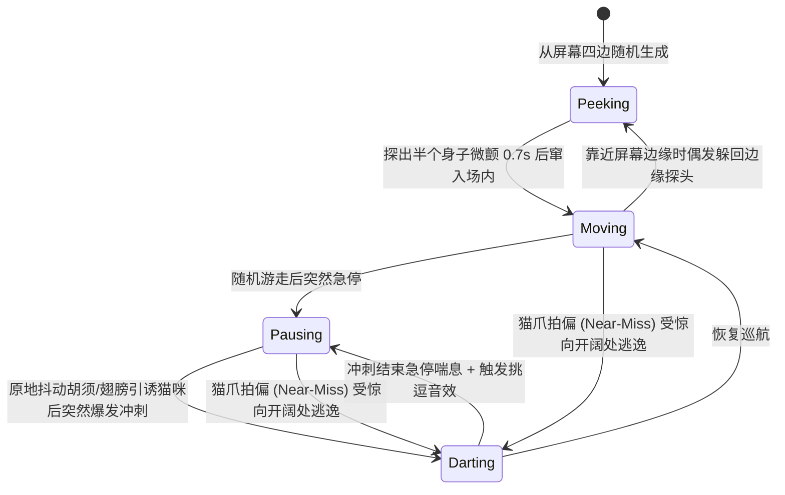

# 🐾 喵喵捕猎 (CatToy) — Peppy Cat 风格 iPad 宠物猫咪互动捕猎游戏

<p align="center">
  
</p>

<p align="center">
  <b>专为宠物猫咪视觉神经与捕猎天性设计的 iPad 全屏互动游戏</b><br/>
  基于猫咪双色视觉科学（450nm 蓝光 / 554nm 黄绿光）· 仿生走停变速 AI · 纯代码实时高频拟声合成 · 多爪防误触
</p>

<p align="center">
  <a href="https://playcattoy.com"></a>
  <a href="https://playcattoy.com/play/"></a>
</p>

<p align="center">
  
  
  
  
</p>

<p align="center">
  <a href="README.md">English</a> · <b>简体中文</b>
</p>

---

## 🌐 在线立即体验（免安装 · 支持 iPad / 平板 / 手机全屏）

- **🏠 官方网站（设计初衷与色彩科学介绍）**：[https://playcattoy.com](https://playcattoy.com)
- **🎮 全屏逗猫游乐场（即开即玩）**：[https://playcattoy.com/play/](https://playcattoy.com/play/)
  - 🐟 [锦鲤池塘 (`?mode=0`)](https://playcattoy.com/play/?mode=0) · 🐭 [窜动小老鼠 (`?mode=1`)](https://playcattoy.com/play/?mode=1) · 🐞 [荧光飞虫 (`?mode=2`)](https://playcattoy.com/play/?mode=2) · 🔵 [电光逗猫棒 (`?mode=3`)](https://playcattoy.com/play/?mode=3) · 🪶 [逗猫仙女棒 (`?mode=4`)](https://playcattoy.com/play/?mode=4)
- **📲 iPad 全屏桌面图标一键安装描述文件**：[https://playcattoy.com/CatToy.mobileconfig](https://playcattoy.com/CatToy.mobileconfig)（在 iPad Safari 中点击或通过「分享 -> 添加到主屏幕」即可全屏无地址栏畅玩）

---

## ✨ 项目简介

**喵喵捕猎 (CatToy)** 是一款受经典猫咪游戏 *Peppy Cat* 启发、专为 iPad 打造的宠物猫咪互动娱乐应用。

本项目完全采用 **零外部图片与音频素材依赖（Zero-Asset Procedural Architecture）** 架构：所有游鱼、老鼠、甲虫、激光与羽毛的骨骼摆动动画、爆裂粒子特效，以及能精准引起猫咪竖耳反应的高频吱吱声、水花气泡声、振翅声和铃铛声，全部由实时数学波形与矢量渲染生成。

项目同时包含：
1. **原生 iPadOS SpriteKit 工程 (`CatToy/`)**：基于 `UIKit + SpriteKit + AVAudioEngine`，支持 120Hz ProMotion 极速帧率与 10 指/多爪并发触控。
2. **全屏离线 WebClip / PWA 引擎 (`web/`)**：单文件 100% 离线可运行的高帧率 Canvas + WebAudio 实现，支持通过 USB (`MobileDevice.framework`) 直接向任何 iPad 推送**永不过期、断网可用的全屏桌面图标**。

---

## 🧬 核心设计原理

### 1. 猫咪双色视觉色彩科学（Cat-Vision Dichromatic Palette）
人类拥有红、绿、蓝三原色视锥细胞，而猫科动物属于**红绿色盲（双色视觉，Dichromacy）**，其视网膜仅对两个波段高度敏感：
- **蓝紫光波段（~450 nm）**
- **黄绿光波段（~554 nm）**

普通的红色激光点在猫咪眼中实际上只是暗淡的灰褐色。因此，**CatToy** 摒弃了对猫咪无效的纯红配色，专为猫咪视网膜调校了高对比度深色背景与高亮黄（`#FFE600`）、电光青（`#00E5FF`）、荧光黄绿（`#C6FF00`）猎物配色，让猎物在猫咪视野中呈现最鲜明的视觉刺激。

### 2. 5 大经典捕猎模式（支持 90 秒自动轮换）

| 模式 | 猎物名称 | 视觉与解剖细节 | 运动特征与粒子反馈 | 实时合成音效 |
| :--- | :--- | :--- | :--- | :--- |
| 🐟 **Koi Pond** | **锦鲤池塘** | 流线型鱼身、双侧胸鳍、高对比度鱼眼、背部斑纹与正弦摆动分节尾鳍 | 优雅游弋、受惊加速冲刺；拍中炸开双层水波纹与上升气泡粒子 | 带通滤波水花声 + 上升变频气泡音 (`520Hz → 1500Hz`) |
| 🐭 **Scurrying Mice** | **窜动小老鼠** | 水滴形身体、粉内耳、亮青鼻尖、6 根高频抖动胡须、S 型分节长尾 | 典型啮齿动物“急停抖须 → 爆发窜出”步态；拍中炸开亮黄/电光蓝星火 | 高频调频正弦吱吱声 (`2900Hz → 4400Hz` 双脉冲滑音) |
| 🐞 **Ladybugs** | **荧光飞虫** | 荧光黄绿甲壳、深色斑点、6 条摆动小腿、双触角、高频扇动透明薄翼 | 蜿蜒曲线爬行、原地振翅引诱；拍中爆裂荧光绿甲壳碎屑粒子 | 调幅高频虫鸣脉冲 (`1800Hz → 3100Hz` 颤音) |
| 🔵 **Cat Laser** | **电光逗猫棒** | 亮青外环 + 明黄核心 + 纯白高光点 + 8 段动态衰减残影拖尾 | 极速折线变向、屏幕中心急停微颤挑逗；拍中释放双环电光冲击波 | 超高频电子啾鸣声 (`3200Hz → 1400Hz` 指数滑音) |
| 🪶 **Feather Wand** | **逗猫仙女棒** | 弯曲羽轴、明黄金属铃铛、亮青丝带与三簇层叠渐变羽毛 | 大弧线飘荡与空中悬停颤动；拍中漫天飘散慢速旋转的羽毛粒子 | 清脆双泛音金属铃铛谐振 (`2637Hz E7 + 3951Hz B7`) |

> 💡 **自动轮换机制**：默认开启 **90 秒自动切换模式**，当猫咪对单一猎物产生适应性疲劳前自动变换视觉与听觉刺激，保持持久好奇心。

---

### 3. 仿生猎物行为状态机（Bio-Inspired Prey State Machine）

猫咪的捕猎本能由**“静止观察（蹲伏摇屁股）→ 突发扑咬”**驱动。如果屏幕上的物体只是机械地匀速移动，猫咪很快就会失去兴趣。`CatBehaviorEngine` 为每个猎物实现了独立的四阶段状态机：



- **边缘探头（Peek-a-boo）**：猎物刷新或靠近屏幕边缘时，会先露出半个脑袋原地微颤，完美模拟躲在沙发缝隙或洞口窥探的小动物。
- **墙角防卡死反射算法（Corner-Escape Steering）**：当猫爪连续在屏幕边缘滑动追赶（`touchesMoved`）时，引擎内置 `0.14s` 受惊冷却与向心偏转算法，猎物会沿着墙壁或向屏幕中央开阔地带逃窜，绝不会卡死在屏幕死角。

---

### 4. 猫爪多点触控与防误触安全设计

- **🐾 多爪并发与肉垫宽容判定**：
  - 同时支持 **最多 10 个触控点**（`isMultipleTouchEnabled = true`），兼容多只猫咪同时围观拍打。
  - 支持**点按拍击（Tap/Pounce）**与**连续挥爪滑抓（Swipe）**两种捕获方式。
  - 考虑到猫爪肉垫面积较大且落点存在偏差，碰撞判定半径在猎物视觉尺寸基础上额外扩大 **`+38pt`（滑抓 `+44pt`）**，确保猫咪每次果断出爪都能获得即时的正反馈。
- **🔒 2.5 秒长按防误触家长锁（Cat-Proof Parental Lock）**：
  - 屏幕右上角设有一个低调的半透明锁形按钮。
  - **短按与多爪踩踏完全免疫**：猫咪踩到按钮只会触发普通涟漪，而且在人类手指按住期间若有猫爪踩到锁按钮，不会打断或重置人类的解锁进度。
  - **长按 2.5 秒解锁**：只有人类手指持续按住 2.5 秒并走完环形进度条，才会弹出设置面板（切换 5 种猎物模式、调节同屏猎物数量 `1~5`、开关 90 秒自动轮换、静音开关、清零计分）。
- **🛡️ 系统手势防护与屏幕常亮**：
  - 启动即激活 `UIApplication.shared.isIdleTimerDisabled = true`，防止猫咪盯梢观察时 iPad 自动息屏。
  - 开启 `preferredScreenEdgesDeferringSystemGestures = .all` 与 `prefersHomeIndicatorAutoHidden = true`，防止猫爪在屏幕边缘扒拉时误触返回主屏幕。

---

## 📂 项目目录结构

```text
cattoy/
├── CatToy.xcodeproj/          # 原生 iOS / iPadOS Xcode 工程 (Deployment Target: iOS 13.0+)
│   └── project.pbxproj
├── CatToy/                    # 原生 Swift 源码目录
│   ├── AppDelegate.swift      # 应用生命周期与屏幕常亮控制
│   ├── GameViewController.swift # SKView 120Hz 配置、多点触控与系统边缘手势防护
│   ├── CatGameScene.swift     # SpriteKit 主场景、多爪碰撞、粒子特效与家长锁面板
│   ├── CatBehaviorEngine.swift # 独立可测试的仿生运动 AI 状态机、色彩与家长锁逻辑
│   ├── PreyNode.swift         # 5 种猎物的多段矢量图形与骨骼动画节点
│   ├── CatAudioSynth.swift    # 基于 AVAudioEngine 的零素材实时 PCM 高频音效合成器
│   └── Info.plist             # 全屏、横竖屏自适应与设备族配置
├── web/                       # 免签名 100% 离线全屏 WebClip / PWA 引擎
│   ├── index.html             # 单文件零依赖 Canvas + WebAudio 完整游戏引擎
│   ├── icon.png               # 猫咪视觉高对比度桌面图标
│   └── CatToy.mobileconfig    # 双模全屏桌面应用描述文件 (含局域网版 + Base64 纯离线版)
├── Tests/
│   └── CatToyTests.swift      # 746 项断言的自动化单元测试套件
└── install_to_ipad.sh         # 一键 USB 真机推送 / 局域网服务 / 自动化测试脚本
```

---

## 🚀 快速安装与运行指南

本项目提供 **3 种安装与运行方式**，兼容从老款 iPad（如 iPadOS 13~16）到最新款 M 系列 iPad Pro。

### 方式一：USB 一键推送全屏离线桌面应用（推荐 · 免开发者证书 · 永不过期）

无需登录 Apple ID，也无需担心免费开发者证书 7 天过期问题。将 iPad 通过 USB 连接 Mac 并点击「信任此电脑」，在终端运行：

```bash
./install_to_ipad.sh
```

脚本会通过 macOS 底层 `MobileDevice.framework` (`com.apple.mobile.MCInstall`) 直接将应用包推送至你的 iPad：
1. 打开 iPad 上的 **「设置 (Settings)」**，点击左侧栏顶部的 **「已下载描述文件 (Profile Downloaded)」**。
2. 点击右上角 **「安装 (Install)」**。
3. 返回 iPad 桌面，即可看到两个全屏应用图标：
   - **🐾 喵喵离线版**：完整游戏引擎已内嵌在图标内，**断开 USB 与 Wi-Fi 也能 100% 全屏运行，且永不过期**。
   - **🐾 喵喵捕猎**：连接局域网服务运行（可通过 `./install_to_ipad.sh --web` 启动）。

### 方式二：Xcode 原生编译安装 (`CatToy.xcodeproj`)

如果你希望安装原生 `SpriteKit` 编译包：
1. 在 Mac 上使用 Xcode 打开 `CatToy.xcodeproj`。
2. 进入 **Signing & Capabilities**，在 **Team** 中选择你的 Apple ID。
3. 选择顶部已连接的 iPad，按下 **`Cmd + R`** 编译并运行。

### 方式三：局域网 Safari / PWA 即开即玩

```bash
./install_to_ipad.sh --web
```

在 iPad 的 Safari 浏览器访问终端提示的局域网地址（例如 `http://192.168.1.9:8765`），点击 Safari 顶部的 **「分享 -> 添加到主屏幕」**，即可从桌面全屏启动。

---

## 🧪 自动化测试

项目内置了针对猎物 AI 状态机、墙角逃逸反射、多爪碰撞判定、家长锁并发防误触、90 秒自动轮换以及 `AVAudioEngine` 多声道 PCM 波形合成器的完整测试套件（共 **746 项断言**）：

```bash
./install_to_ipad.sh --test
```

输出示例：
```text
🧪 正在编译并运行自动化单元测试套件 (CatToyTests)...
🐾 Running CatToy Automated Test Suite...
✅ Assertions Passed: 746, Failed: 0
```

---

## 💡 给铲屎官的使用小贴士

1. **开启 iPad「引导式访问」更安心**：如果家里猫咪动作特别猛烈，可以在 iPad **「设置 -> 辅助功能 -> 引导式访问」** 中开启引导式访问，进入游戏后连按三下电源键即可彻底锁定在当前应用内。
2. **配合真实零食奖励**：在猫咪玩耍 10~15 分钟、成功拍中若干猎物后，给猫咪一点冻干或零食奖励，能形成完整的“搜寻 → 扑咬 → 进食”捕猎闭环，避免猫咪产生挫败感。
3. **调高 iPad 音量**：游戏内置的实时合成吱吱声、虫鸣与水花声是吸引猫咪注意力的关键，建议将 iPad 媒体音量调至 50% 以上并将 iPad 平放在地毯或防滑垫上。

---

## 📄 License

MIT License
